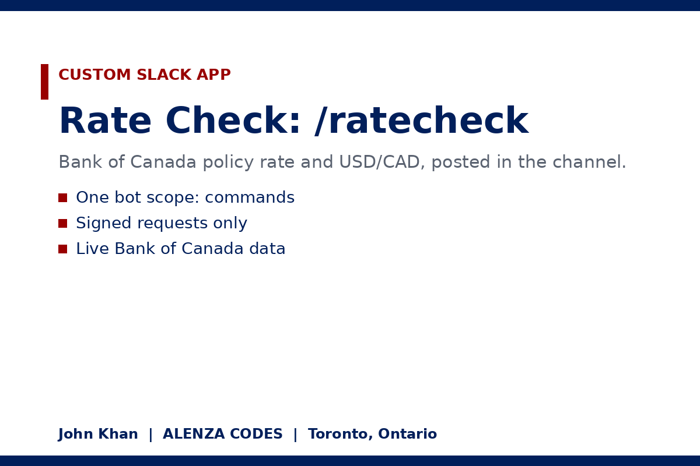

# Rate Check: a Slack App for Bank of Canada Numbers

Type `/ratecheck` in any Slack channel and Rate Check posts the latest Bank of Canada target for the overnight rate and the daily USD/CAD rate, each with its date and source.



| Command | Reply |
| --- | --- |
| `/ratecheck` | Policy rate and USD/CAD |
| `/ratecheck rate` | Policy rate only |
| `/ratecheck fx` | USD/CAD only |
| `/ratecheck help` | How to use it (only you see this) |

## Permissions
One bot scope: `commands`. A slash command needs it, and answering a slash command in the HTTP response needs nothing else. The app cannot read messages, list channels or post on its own.

## How it works
1. Slack sends a signed POST to `/slack/ratecheck`.
2. `app/server.js` checks the `X-Slack-Signature` header with the app's signing secret and rejects anything unsigned or older than five minutes.
3. It reads series V39079 (target for the overnight rate) and FXUSDCAD from the Bank of Canada Valet API: https://www.bankofcanada.ca/valet/observations/V39079,FXUSDCAD/json?recent=1
4. It answers with `response_type: in_channel` so the whole channel sees the numbers.

No dependencies. Node 20 or newer.

## Run and test locally
```bash
cd app
node test.js        # signs fake Slack requests and checks every reply
SLACK_SIGNING_SECRET=your_secret node server.js
```
Sample test output from Nov 12, 2026: [test-output.txt](test-output.txt)

## Deploy
`render.yaml` describes a free Render web service (root `app`, start `node server.js`, health check `/health`). Set `SLACK_SIGNING_SECRET` in the service settings, then put `https://<your-host>/slack/ratecheck` in the slash command URL in `manifest.yaml`.

## Install in Slack
1. https://api.slack.com/apps, Create New App, From a manifest, paste `manifest.yaml`.
2. Upload `app-icon.png` under Basic Information, Display Information.
3. Copy the signing secret into the host's `SLACK_SIGNING_SECRET`.
4. Install to the workspace and type `/ratecheck` in a channel.

Built by John Khan, ALENZA CODES, Toronto, Ontario. Data: Bank of Canada.
